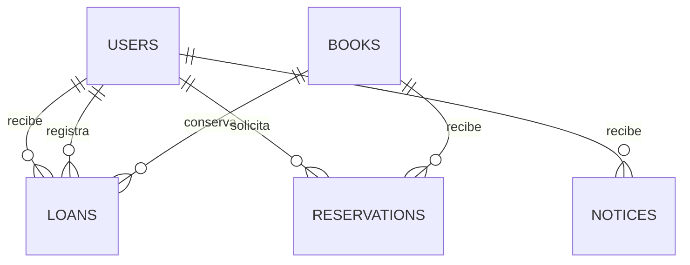
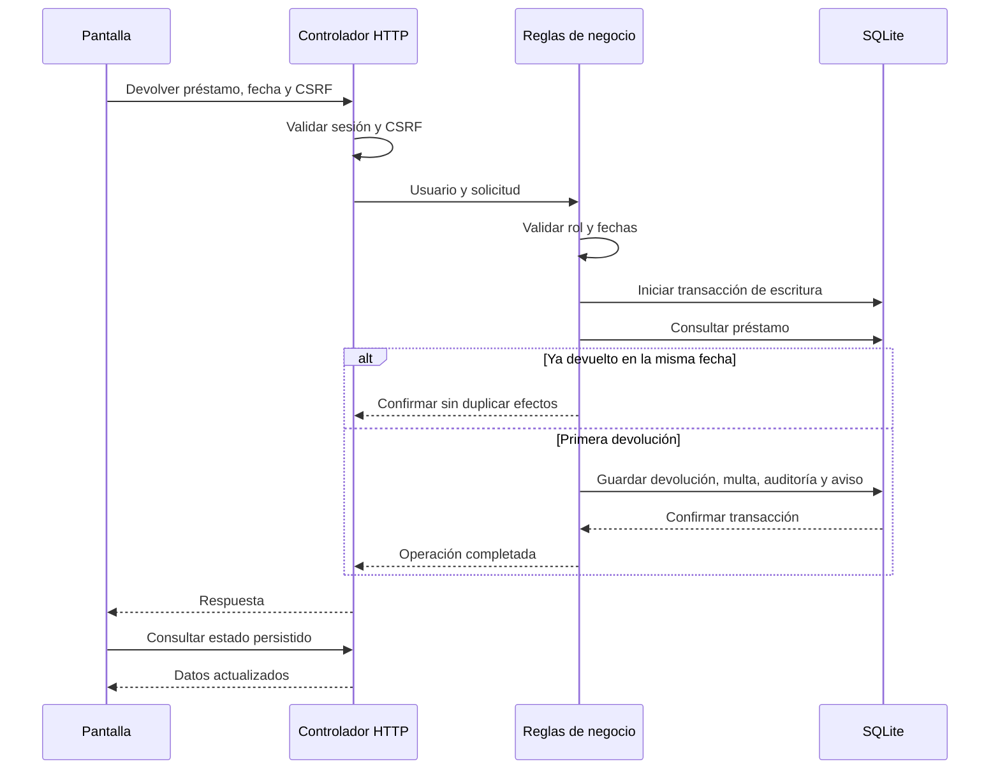

# Diseño y relación con el caso

## Decisiones

La carga, presupuesto y capacidad de operación no están especificados. Se entrega una base ejecutable local que permite verificar reglas. La migración distribuida queda como evolución sujeta a mediciones. El catálogo expone ejemplares individuales: cada código es una unidad física, aunque dos unidades puedan compartir título y autor.

Bibliotecario creador y estudiante destinatario son relaciones distintas en `loans.created_by` y `loans.user_id`. La devolución mantiene la fecha inicial y el vencimiento. No se implementa edición libre de préstamos o multas: el cambio demostrado es la devolución, que conserva su auditoría.

## Modelo de datos

`books` representa ejemplares. Cada préstamo corresponde a un ejemplar, un estudiante y un creador. El índice parcial impide más de un préstamo activo por ejemplar. Cada reserva tiene un estudiante y un ejemplar; no puede duplicarse una reserva activa de esa pareja. La auditoría almacena actor, evento, detalle y fecha. Las altas de ejemplares y las operaciones transaccionales no se borran desde la interfaz.

## Devolución autorizada

El rol se valida en la lógica de negocio. Un estudiante puede reservar para sí mismo y consultar sus propios registros, pero no devolver ni prestar. Un rechazo por rol se conserva en auditoría sin alterar el préstamo. Solicitudes sin sesión o CSRF válido se rechazan antes de la operación.

## Reportes

Para un corte C se incluyen préstamos con inicio <= C. Se consideran activos aquellos sin devolución o con devolución > C. Un activo está vencido si vencimiento < C. Los devueltos al corte tienen devolución <= C. El histórico de atrasos requiere devolución > vencimiento y devolución <= C. Multa liquidada = suma de las multas de los préstamos devueltos al corte.

No se permite editar fechas originales después de registrar un préstamo. Por ello esta reconstrucción por fecha sirve al escenario implementado; si se agregan renovaciones se necesitará un historial temporal de vencimientos.

## Fases de modernización propuestas

| Fase | Responsable funcional | Entregable | Aceptación | Recuperación |
|---|---|---|---|---|
| Diagnóstico | Equipo + responsable biblioteca | Línea base de carga y errores | Mediciones revisadas | Mantener sistema actual |
| Validación local | Desarrollo + evaluador | Este prototipo y sus pruebas | Recorridos de aceptación | Restaurar copia SQLite |
| Piloto institucional | Desarrollo + infraestructura | Persistencia y autenticación institucional | Pruebas integrales y recuperación | Volver a versión y respaldo validados |
| Extracción gradual | Arquitectura + operaciones | Servicio priorizado según mediciones | Contratos, idempotencia y carga verificadas | Reenrutar a implementación anterior |

Los responsables son roles propuestos, no asignaciones institucionales confirmadas. No se inventan plazos ni capacidad de infraestructura.

## Gestión de multas y pagos

`payments.loan_id` es clave primaria y referencia al préstamo: admite un único pago completo por multa. Guarda importe, actor y fecha. Una transacción verifica la devolución y multa, registra el pago, auditoría y aviso. La repetición confirma sin duplicar. Se conserva `loans.fine` como importe generado; el saldo actual suma las multas sin registro de pago. La consulta histórica de reportes sigue mostrando multas generadas al corte. No reconstruye saldos históricos de pago.

## Identidades y enrolamiento vigentes

Jorge es el único bibliotecario. La tabla roster contiene los 20 estudiantes proporcionados y no asigna RUT. La lista no incluye a Giordano porque fue identificado como profesor. El enrolamiento selecciona roster_id y RUT; el servidor fija el rol estudiante aunque una solicitud intente enviar otro rol. Un índice parcial impide más de un usuario con rol bibliotecario.

Las cuentas con RUT nulo no pueden ingresar. La migración de cuentas anteriores conserva préstamos y referencias, pero invalida sus credenciales hasta el enrolamiento. Las instalaciones nuevas tienen catálogo y Jorge, sin préstamos ni estudiantes habilitados. No hay sección de evaluación ni credenciales públicas en la pantalla de acceso.
